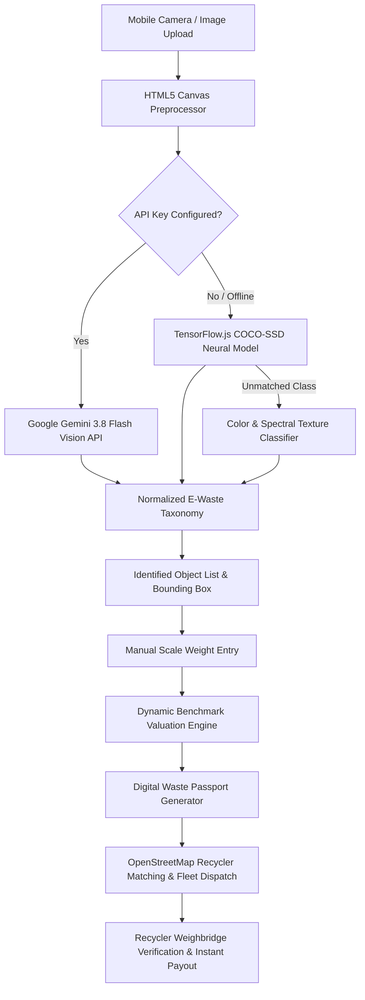

# AVASAR (अवसर) – Kabadiwala-Connect E-Waste Network

<p align="center">
  
  
  
  
  
  
  
</p>

> **An AI-powered, edge-vision circular economy platform that integrates informal scrap collectors (कबाड़ीवाला) into the formalized, authorized e-waste recycling value chain with fair pricing, digital traceability, and multilingual accessibility.**

---

## 📌 Problem Statement & Real-World Impact

India generates over **1.71 million tonnes of e-waste annually**, ranking 3rd globally. Shockingly, **over 90–95% of this waste is processed by the informal sector** (*Kabadiwalas* and micro-aggregators):
- ⚠️ **Health & Environmental Hazards**: Open burning of wire insulation generates toxic dioxins; crude battery cracking causes chemical acid burns.
- 📉 **Price Exploitation**: Informal collectors lack real-time market benchmark rates and are often underpaid by middlemen.
- 🔍 **Zero Supply Chain Traceability**: Formal recyclers and Urban Local Bodies (ULBs) struggle to meet Extended Producer Responsibility (EPR) quotas because informal scrap flows remain unregistered.

**AVASAR (अवसर)** solves this by creating a **digital bridge**: giving frontline collectors real-time optical AI scrap detection, fair pricing benchmarks, verifiable Digital Waste Passports, and direct matching with certified recyclers.

---

## 🚀 Key Engineering & Architecture Highlights

### 1. 👁️ Dual-Engine Computer Vision System
- **Client-Side Edge Inference (TensorFlow.js + COCO-SSD)**:
  - Runs **100% locally in the browser** via WebAssembly/WebGL.
  - Zero server hosting latency, zero API costs, and works completely offline.
  - Detects real objects (smartphones, laptops, monitors, appliances, peripherals) and renders dynamic **optical bounding boxes** directly on the live camera viewport.
  - Custom heuristic color/texture analyzer detects bare Printed Circuit Boards (PCBs) and copper wire coils.
- **Multimodal Cloud Vision (Google Gemini 3.8 Flash)**:
  - Deep chip-level component decomposition and hazard classification via environment-configured Gemini Vision APIs (`VITE_GEMINI_API_KEY`).
  - Graceful fallback: If offline or without an API key, edge neural detection runs seamlessly without interrupting the user.

### 2. ⚖️ Physical Scale Calibration (Anti-Hallucination UX)
- Avoids AI weight hallucination: Vision AI classifies the object category and hazard level, while **weight entry is strictly user-controlled** from physical weighing scales.
- Real-time reactive pricing formula:
  $$\text{Fair Scrap Payout (₹)} = \text{Verified Scale Weight (kg)} \times \text{Benchmark Rate (₹/kg)}$$
- Dynamic batching: Collectors can scan multiple scrap items into a unified **Identified Object List** with live aggregate weight and total earnings before dispatch.

### 3. 📜 Digital Waste Passport & Custody Tracking
- Generates unique verifiable passport manifests (e.g. `AVS-2026-8491`) with GPS metadata.
- **6-Stage Verifiable Chain-of-Custody**:
  $$\text{Requested} \longrightarrow \text{Transit Assigned} \longrightarrow \text{Weighbridge Verified} \longrightarrow \text{Recycler Handover} \longrightarrow \text{Settled} \longrightarrow \text{EPR Certificate Issued}$$
- Instant printable transaction dockets and custody receipts with QR code tracking.

### 4. 🌐 Inclusive, Low-Literacy Accessibility
- **Full Bilingual Support**: Instant toggling between **English** and **Hindi (हिन्दी)** across all views.
- **Text-to-Speech (TTS) Voice Engine**: Native integration with the browser's `SpeechSynthesis` Web API to read out detected items, weights, and payout valuations in spoken Hindi and English for low-literacy collectors.

### 5. 👥 4-Stakeholder Unified Ecosystem
AVASAR provides tailored portals for all circular economy participants:
| Role | Capabilities |
| :--- | :--- |
| **Collector (कबाड़ीवाला)** | Live camera scanner, scrap value estimator, recycler matching, transaction wallet, and safety guidelines. |
| **Authorised Recycler** | Inbound lot management, weighbridge verification, UPI/Cash payment disbursement, and inventory custody logs. |
| **Citizen / Household** | Doorstep pickup scheduling, citizen scrap estimator, eco-reward badges, and neighborhood drop-off points. |
| **ULB / Municipal Corporation** | Hyper-local ward analytics, CPCB compliance tracking, landfill diversion telemetry, and EPR audit manifests. |

---

## 🏗️ System Architecture



---

## 💻 Tech Stack & Engineering Decisions

| Domain | Technology | Rationale |
| :--- | :--- | :--- |
| **Framework** | **React 19 + TypeScript 6** | Strict type safety, zero `any` types, scalable component architecture. |
| **Build Tool** | **Vite 8** | Sub-second HMR and production bundle optimization with modern ES modules. |
| **Styling** | **Tailwind CSS v4** | Clean utility-first design, mobile-first responsive layout, ergonomic Forest Green `#176B45` theme. |
| **Edge AI** | **@tensorflow/tfjs + COCO-SSD** | Instant, zero-cost, in-browser neural object detection that runs on low-end devices. |
| **Cloud AI** | **Google Gemini 3.8 Flash** | High-precision multimodal identification for fine-grained scrap categorization. |
| **GIS & Maps** | **Leaflet + OpenStreetMap** | Open-source geographic mapping without proprietary API lock-in. |
| **Audio** | **Web Speech API (`SpeechSynthesis`)** | Native zero-dependency Hindi/English audio readout for informal workers. |
| **Persistence** | **LocalStorage + Offline State Machine** | Offline-first reliability ensuring records persist even without network connectivity. |

---

## 📂 Project Directory Structure

```text
miniproject/
├── public/                 # Static assets & icons
├── src/
│   ├── assets/             # Brand logos & media assets
│   ├── components/         # Modular React UI components
│   │   ├── WasteScannerModule.tsx   # Live camera feed, optical reticle, batch inventory
│   │   ├── CollectorHome.tsx        # Kabadiwala dashboard with wallet & metrics
│   │   ├── RecyclerPortal.tsx       # CPCB-authorized recycler receiving & weighbridge portal
│   │   ├── CitizenDashboardView.tsx # Citizen doorstep pickup & scrap scheduler
│   │   ├── MunicipalULBDashboardView.tsx # Municipal ULB ward telemetry & EPR tracker
│   │   ├── WastePassportDetail.tsx  # Verifiable chain-of-custody docket & receipt
│   │   ├── RecyclerDiscovery.tsx    # Leaflet OpenStreetMap geo-matching
│   │   ├── ScrapEstimatorPage.tsx   # Benchmark rate calculator & rate matrix
│   │   ├── SafetyAdvisor.tsx        # Toxics prevention & safe dismantling guidelines
│   │   └── AppHeader.tsx / BottomNav.tsx # Navigation & role switching
│   ├── context/
│   │   └── AppContext.tsx           # Global state, persistence, wallet & audio state
│   ├── data/
│   │   ├── avasarData.ts            # Material price benchmarks, verified facilities
│   │   └── mockData.ts              # ULB wards & circularity telemetry
│   ├── types/
│   │   ├── avasar.ts                # TypeScript domain models (Passports, Facilities)
│   │   └── index.ts                 # Role & diagnostic types
│   ├── utils/
│   │   ├── localDetector.ts         # TensorFlow.js COCO-SSD & texture computer vision
│   │   ├── visionService.ts         # Google Gemini 3.8 Flash multimodal API service
│   │   ├── avasarI18n.ts            # Bilingual English / Hindi localization dictionaries
│   │   └── i18n.ts                  # Extended translations
│   ├── App.tsx                      # Root application controller & tab router
│   ├── main.tsx                     # Vite React DOM entrypoint
│   └── index.css                    # Tailwind CSS v4 styling rules
├── .env.example            # Environment configuration template
├── package.json            # Dependencies & build scripts
├── tsconfig.json           # Strict TypeScript configuration
└── vite.config.ts          # Vite build & plugin configuration
```

---

## ⚡ Getting Started (Local Setup)

### Prerequisites
- **Node.js**: v18.0.0 or higher
- **npm**: v9.0.0 or higher

### 1. Clone & Install
```bash
git clone https://github.com/harshvardhan-dot/mini-project.git
cd mini-project
npm install
```

### 2. Configure Environment (Optional)
For cloud-based Gemini Vision AI, copy `.env.example` to `.env`:
```bash
cp .env.example .env
```
Inside `.env`, add your free API key from [Google AI Studio](https://aistudio.google.com/app/apikey):
```env
VITE_GEMINI_API_KEY=AIzaSyYourActualKeyHere
```
*(Note: If no API key is provided, the onboard TensorFlow.js edge detector automatically runs out-of-the-box!)*

### 3. Start Development Server
```bash
npm run dev
```
Open **`http://localhost:5173/`** in your browser.

### 4. Build for Production
```bash
npm run build
npm run preview
```

---

## 🧪 Demonstration Walkthrough (10-Step Evaluation)

1. **Launch App**: Select the **E-Waste Collector (कबाड़ीवाला)** role.
2. **Explore Dashboard**: View live metrics (Total Waste Diverted, Estimated Earnings, Verified Handovers).
3. **Open Scanner**: Navigate to the **Scan** tab. Allow camera permissions to activate the live optical reticle.
4. **Identify Object**:
   - Point your camera at an item (e.g. phone, laptop, cables, circuit board) and click **Capture & Identify** (or upload a photo).
   - Watch the neural scanner detect the object, draw a **green bounding box**, and classify the material category with confidence percentage.
5. **Enter Verified Weight**: Type the measured scale weight (e.g. `2.5 kg`). Watch the fair market value update instantly.
6. **Batch Multiple Items**: Click **Scan Another** to add more items to your active **Identified Object List**.
7. **Match Authorised Recycler**: Click **Generate Waste Passport & Select Recycler**. Browse local facilities sorted by distance, price, and verification rating.
8. **Generate Digital Passport**: Confirm handover to generate a unique Passport ID (`AVS-2026-XXXX`) with an immutable custody timeline.
9. **Switch to Recycler Role**: Use the top role switcher to enter the **Authorised Recycler Portal**. View the lot, verify the weighbridge reading, and record UPI/Cash settlement.
10. **Verify Settlement & Offline Resilience**: Return to the Collector Portal to see payment confirmation. Refresh the page (`F5`) to verify that all data persists via local storage.

---

## 🛡️ Safety, Compliance & Circularity Standards

- **CPCB / SPCB Regulatory Compliance**: Aligned with India's E-Waste (Management) Rules 2022 and Extended Producer Responsibility (EPR) reporting requirements.
- **Hazard Prevention Guidelines**:
  - 🚫 *Zero Wire Burning*: Highlights carcinogenic dioxin hazards and advocates mechanical stripping.
  - 🚫 *Zero Battery Cracking*: Visual warnings for thermal runaway risks in swollen lithium-ion cells.
- **Ethical AI**: Transparent user-in-the-loop validation prevents automated valuation errors, empowering informal workers with complete agency over pricing decisions.

---

## 👨‍💻 Developer & Project Context

Developed as an engineering project highlighting **Full-Stack Web Development, Edge AI / Computer Vision, Inclusive Human-Computer Interaction (HCI), and Circular Economy Systems**.

- **GitHub Repository**: [harshvardhan-dot/mini-project](https://github.com/harshvardhan-dot/mini-project)
- **Deployment Ready**: Optimized for instant deployment on **Vercel** / **Netlify** with automatic HTTPS and PWA capabilities.
